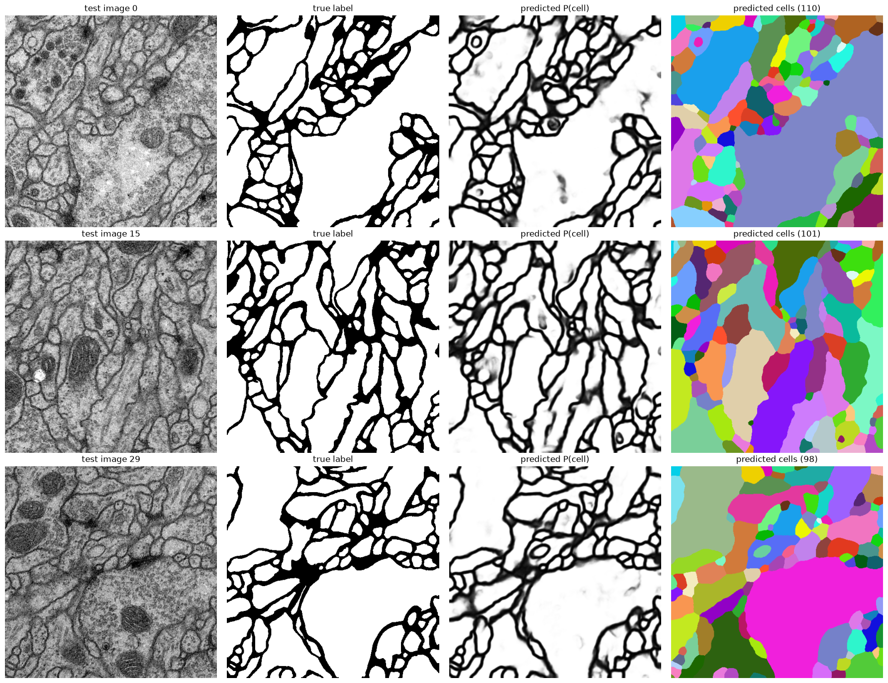
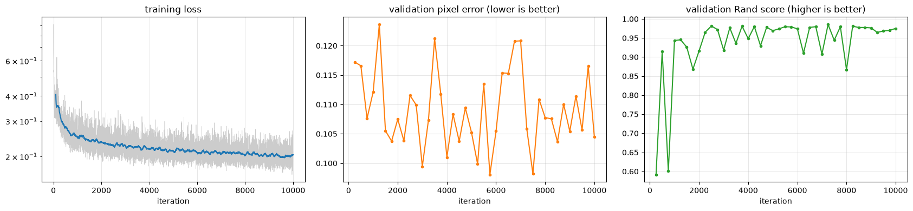
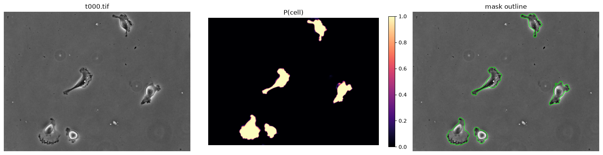

# U-Net in PyTorch: the original release, ported and retrained

A PyTorch port of the original U-Net from [Ronneberger, Fischer and Brox (2015)](https://arxiv.org/abs/1505.04597), in two parts:

1. **The authors' trained network, running in PyTorch.** The released Caffe weights (`phseg_v5`, from the ISBI 2015 cell tracking challenge) are loaded into an exact PyTorch copy of the network. No Caffe or MATLAB is needed.
2. **Training from scratch on the ISBI 2012 EM challenge**, with the paper's ingredients: valid convolutions, overlap-tile prediction, the weighted loss (Eq. 2) and elastic-deformation augmentation. It trains in about 11 minutes on a laptop RTX 3070 Ti.

Both are Jupyter notebooks written for people new to PyTorch. Every step is explained before it runs.



## Results on the ISBI 2012 test set

Scored on all 30 test slices with Python versions of the challenge's metrics ([`pyunet/challenge_metrics.py`](pyunet/challenge_metrics.py)). Lower is better.

| | Pixel error | Rand error | Warping error |
|---|---|---|---|
| U-Net paper (Table 1) | 0.0611 | 0.0382 | 0.000353 |
| This repo, default settings | 0.0601 | 0.0449 | not computed |

The paper trained for about 10 hours on all 30 training slices and averaged over 7 rotations at test time. This repo trains for 11 minutes on 25 slices, holding 5 back for validation, and averages over 4 flips. The metrics are re-implementations, so expect small differences from the official Fiji scoring code.

## What's here

| Path | What it is |
|---|---|
| [`train_isbi2012.ipynb`](train_isbi2012.ipynb) | Train a U-Net on ISBI 2012, step by step, and score it on the test set |
| [`unet_phseg_demo.ipynb`](unet_phseg_demo.ipynb) | Run the authors' released network on their sample cell images |
| [`pyunet/model.py`](pyunet/model.py) | The network, matching `phseg_v5-train.prototxt` layer for layer |
| [`pyunet/caffemodel.py`](pyunet/caffemodel.py) | Reads `.caffemodel` weights with numpy only |
| [`pyunet/tiling.py`](pyunet/tiling.py) | Overlap-tile prediction with mirror padding and flip averaging |
| [`pyunet/training.py`](pyunet/training.py) | Data loading, the Eq. 2 weight map, GPU augmentation, loss and metrics |
| [`pyunet/challenge_metrics.py`](pyunet/challenge_metrics.py) | Challenge-style pixel error and Rand error |
| [`check_port.py`](check_port.py) | Sanity checks that the weights load and behave correctly |
| [`unet_notes.md`](unet_notes.md) | Study notes on the paper |

## Setup

These steps use conda; any Python 3.12 environment works.

```bash
conda create -n unet -c conda-forge python=3.12 -y
conda activate unet
pip install -r requirements.txt
python -m ipykernel install --user --name unet --display-name "Python (unet)"
```

`requirements.txt` installs PyTorch built for CUDA 12.4, for NVIDIA GPUs. Without an NVIDIA GPU everything still runs, but training is very slow.

## Get the data

The third-party files aren't in this repo. Download them and unpack them into the repo folder:

| Folder | Download | Needed for |
|---|---|---|
| `u-net-release/` | [u-net-release-2015-10-02.tar.gz](https://lmb.informatik.uni-freiburg.de/people/ronneber/u-net/u-net-release-2015-10-02.tar.gz) (185 MB), from the [U-Net page](https://lmb.informatik.uni-freiburg.de/people/ronneber/u-net/) | the demo notebook and `check_port.py` |
| `ISBI-2012-challenge/` | [ISBI-2012-challenge.zip](https://downloads.imagej.net/ISBI-2012-challenge.zip), from the [challenge page](https://imagej.net/events/isbi-2012-segmentation-challenge) | the training notebook |

The layout should end up like this:

```
u-net-release/phseg_v5.caffemodel
u-net-release/PhC-C2DH-U373/01/t000.tif
ISBI-2012-challenge/train-volume.tif   (and train-labels, test-volume, test-labels)
```

## Run

```bash
python check_port.py
```

```bash
jupyter lab
```

Open either notebook, choose the **Python (unet)** kernel, and use **Run All**.



## How the released network differs from the paper's figure

Reading `phseg_v5-train.prototxt` shows a few details the paper doesn't mention. The port copies all of them so the released weights load and behave identically:

- The last up-convolution keeps 128 channels, not 64, so the network has 31,100,354 parameters rather than 31,030,658.
- There is a ReLU after every up-convolution.
- Dropout (0.5) comes after both the d3 and the d4 blocks.
- The released cell-tracking model uses `ignore_label: 2` for unannotated pixels instead of the Eq. 2 weight map.



## Credits

- **U-Net:** O. Ronneberger, P. Fischer, T. Brox. *U-Net: Convolutional Networks for Biomedical Image Segmentation.* MICCAI 2015. [arXiv:1505.04597](https://arxiv.org/abs/1505.04597). The trained weights and sample images come from the authors' release; see its `Copyright.txt`.
- **ISBI 2012 data:** A. Cardona et al. *An integrated micro- and macroarchitectural analysis of the Drosophila brain by computer-assisted serial section electron microscopy.* PLoS Biology, 2010. [doi:10.1371/journal.pbio.1000502](https://doi.org/10.1371/journal.pbio.1000502)
- **Challenge metrics:** V. Jain et al. *Boundary learning by optimization with topological constraints.* CVPR 2010. [doi:10.1109/CVPR.2010.5539950](https://doi.org/10.1109/CVPR.2010.5539950)
